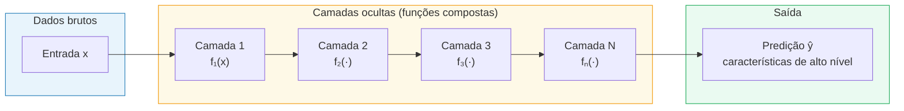
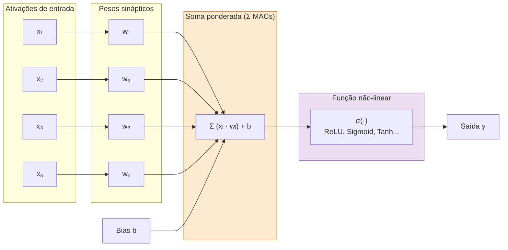
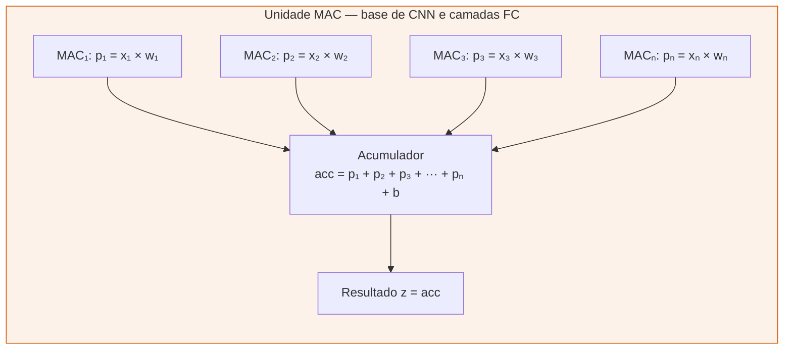
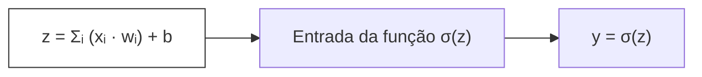
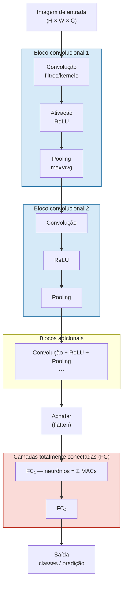
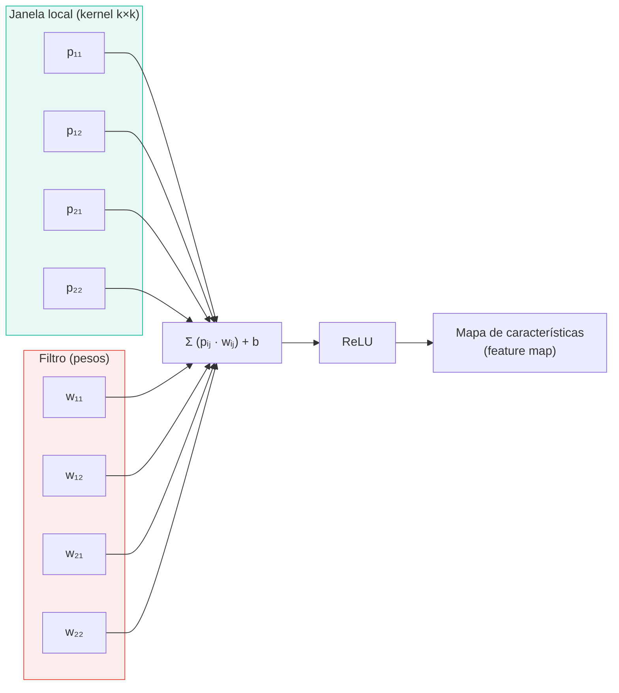
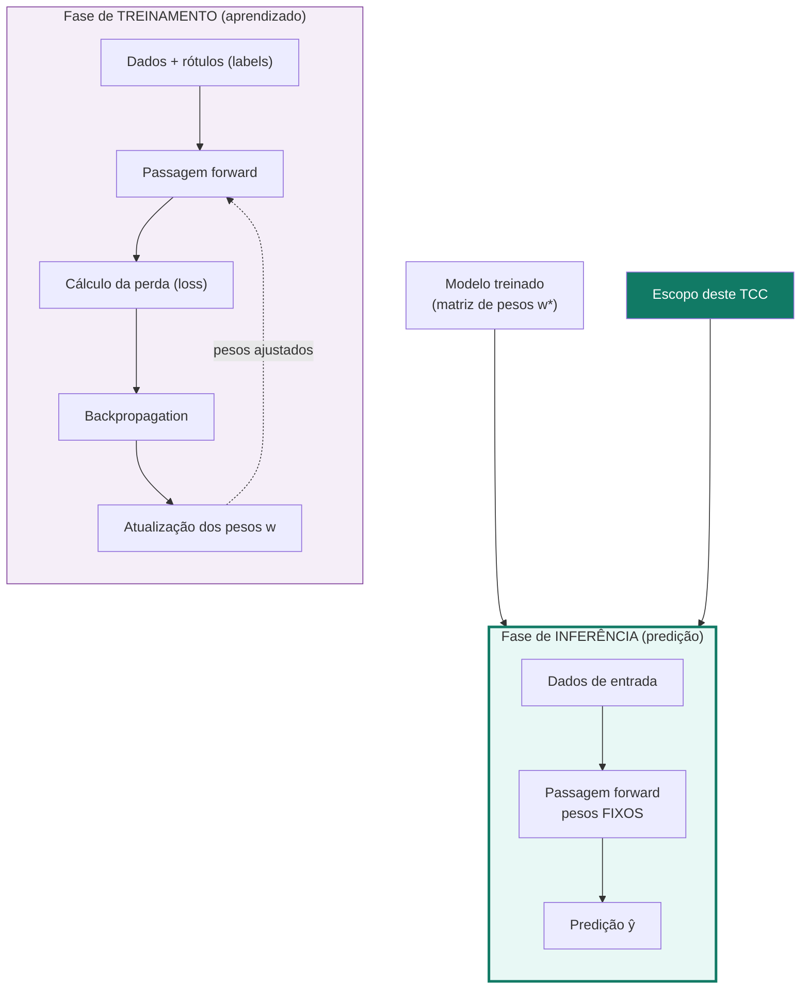
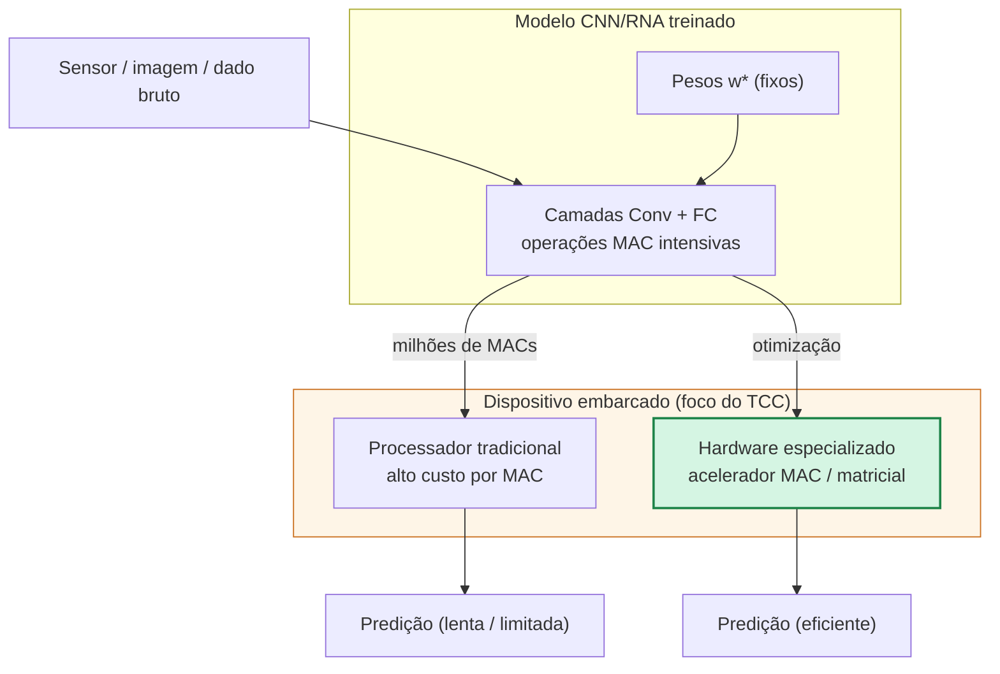
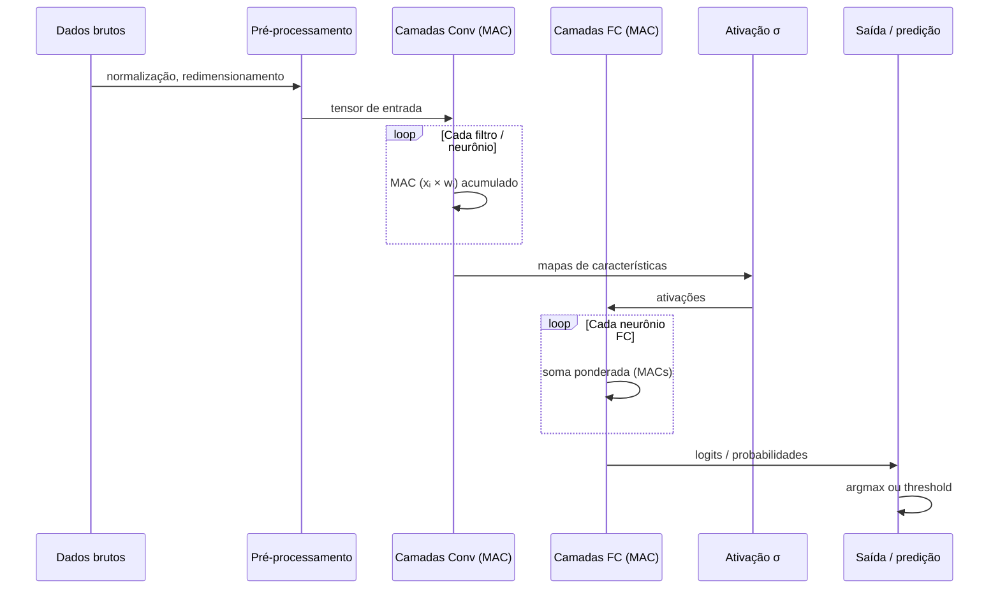

# Diagramas Mermaid — RNAs, CNN e Inferência (TCC)

Diagramas prontos para exportar como imagem (Mermaid Live Editor, VS Code, ou extensões LaTeX/Markdown).

---

## Figura 1 — Modelo de Deep Learning (composição em camadas)

---

## Figura 2 — Neurônio artificial (soma ponderada + função de ativação)

---

## Figura 3 — Operação MAC (Multiply-and-Accumulate)

**Equivalência matemática:**

---

## Figura 4 — Arquitetura típica de uma CNN

---

## Figura 5 — Convolução como janela deslizante (MACs locais)

---

## Figura 6 — Treinamento vs. Inferência

---

## Figura 7 — Inferência embarcada e custo computacional (MAC)

---

## Figura 8 — Visão geral do pipeline de inferência (sequência)

---

## Como exportar para o TCC

1. **Mermaid Live Editor:** https://mermaid.live — cole o código e exporte PNG/SVG.
2. **VS Code / Cursor:** extensão "Markdown Preview Mermaid Support" + export PDF.
3. **LaTeX:** pacote `mermaid` ou incluir SVG exportado com `\includegraphics`.

### Sugestão de legendas (TCC)

| Figura | Legenda sugerida |
|--------|------------------|
| 1 | Composição de um modelo de deep learning em camadas ocultas sucessivas. |
| 2 | Computação clássica de um neurônio artificial: soma ponderada seguida de função de ativação não-linear. |
| 3 | Operação fundamental MAC (Multiply-and-Accumulate) na base das camadas convolucionais e totalmente conectadas. |
| 4 | Arquitetura típica de uma rede convolucional (CNN) com blocos Conv–ReLU–Pool e camadas FC. |
| 5 | Operação de convolução como produto escalar local (MAC) entre janela de entrada e kernel. |
| 6 | Fases de treinamento (backpropagation) e inferência; o projeto foca exclusivamente na inferência. |
| 7 | Desafio de inferência em dispositivos embarcados motivado pelo alto volume de operações MAC. |
| 8 | Sequência do pipeline de inferência desde dados brutos até a predição final. |
